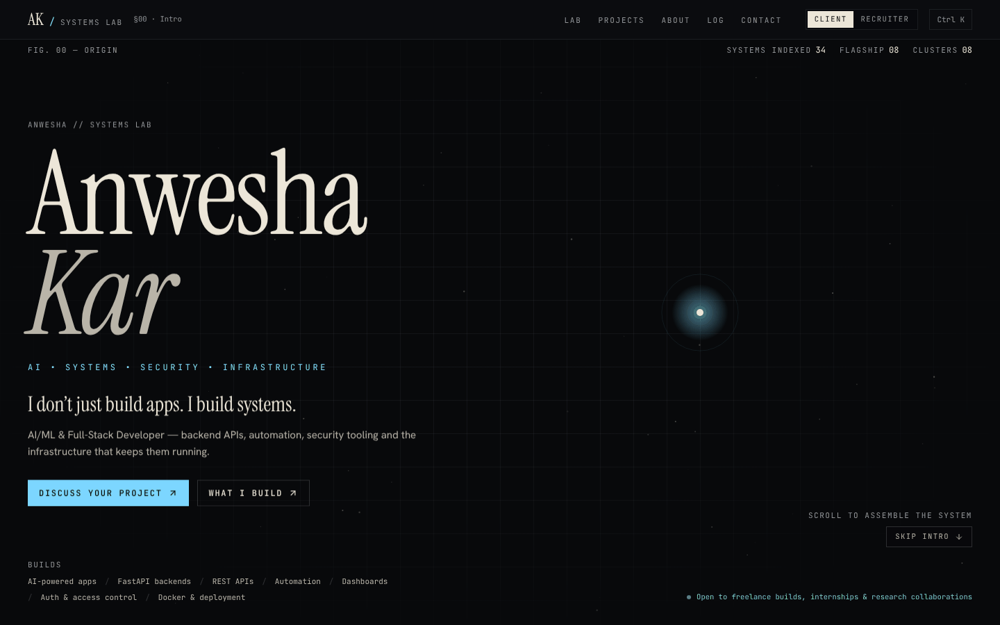
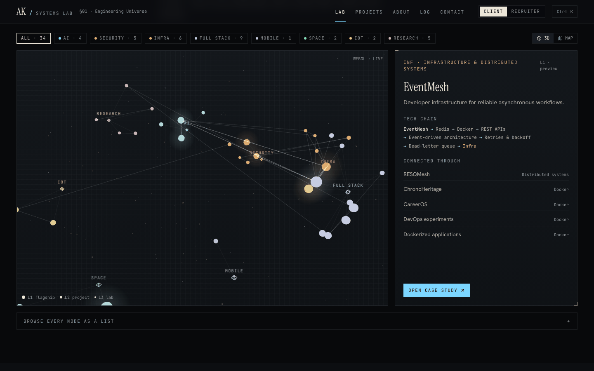
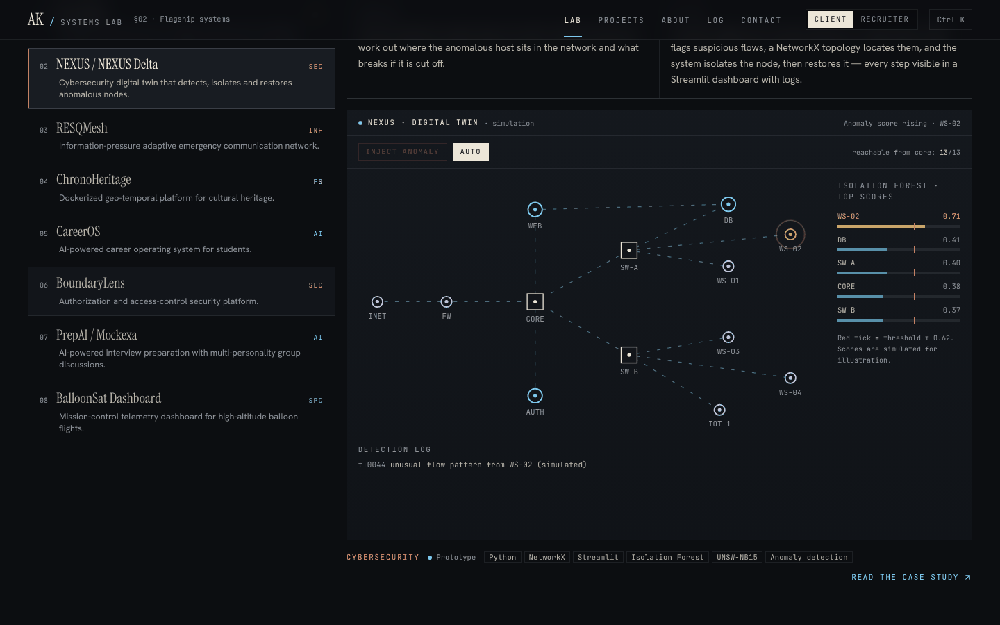
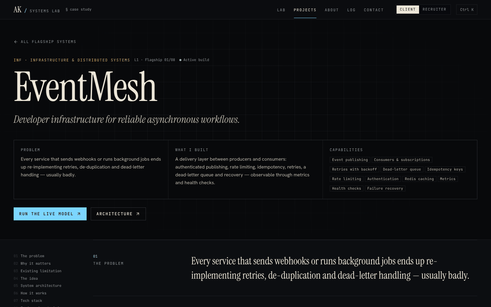
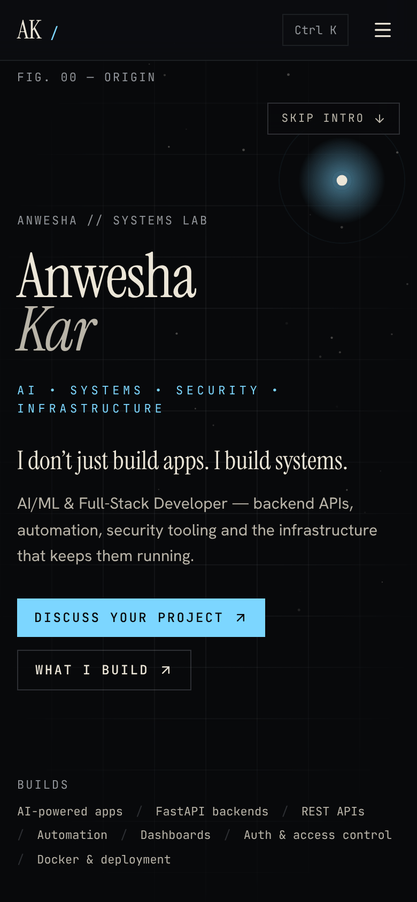

# ANWESHA // SYSTEMS LAB

The portfolio of **Anwesha Kar** — AI/ML & full-stack developer working across AI, backend APIs, security and infrastructure.

> I don’t just build apps. I build systems.

The site is laid out like an engineering lab rather than a template. Projects sit as nodes in a 3D constellation, the flagship systems each run as an interactive simulation, and every case study has a data-driven architecture diagram.



| Engineering Universe | Flagship simulations |
| --- | --- |
|  |  |
| **Case study** | **Mobile** |
|  |  |

## Features

- **Opening sequence.** A scroll-driven canvas: a seed node turns into the project constellation, then hands off to the Engineering Universe. The name, positioning and CTAs are visible from the first frame, and there is a *Skip intro* button.
- **Engineering Universe.** A React Three Fiber scene with 34 projects in 8 clusters, linked wherever two projects share a technology or concept. Hovering traces a project's connections, clicking opens it in the inspector, and the camera dollies in as you scroll. There is an SVG map fallback for mobile, for browsers without WebGL, or if you prefer it.
- **Eight flagship simulations.** These are illustrative models, and each one is labelled as a simulation:
  - EventMesh: retries, DLQ, idempotency, rate limiting
  - NEXUS: anomaly detection, then isolation and restore
  - RESQMesh: information-pressure payload shaping
  - ChronoHeritage: a request's journey across the containers
  - CareerOS: the career constellation
  - BoundaryLens: an IDOR/BOLA authorization playground
  - PrepAI: a multi-persona group discussion with a rubric
  - BalloonSat: mission control running on a standard-atmosphere model
- **Case-study template.** Each flagship page goes through problem, why it matters, limitation, idea, architecture, how it works, stack, decisions, reliability, challenges, implementation, live model, lessons and next iteration. It ends with a CTA tied to that project.
- **Project hierarchy.** Projects are split into L1 flagship systems, L2 substantial projects and L3 lab experiments. You can filter by level or cluster, or search in plain language.
- **Client / Recruiter mode.** Client mode leads with services, each linked to the projects that back it up. Recruiter mode leads with technical depth, research and experience. The choice is saved in `localStorage`.
- **⌘K / Ctrl K command palette.** Fully keyboard-driven. It searches projects, technologies and sections and can switch modes. The search is local and needs no API key. Try `FastAPI`, `docker`, `distributed systems` or `projects using react`. Easter eggs: `lumos`, `nox`, `mischief managed`.
- **Technology graph.** A layered network running ANWESHA → clusters → technologies → projects. Selecting a technology highlights every project that uses it.
- **How I work.** A seven-stage delivery pipeline that lists the artifact each stage produces.
- **Engineering timeline.** A signal travels down the line as you scroll. Dates appear only where they are confirmed.
- **Build Log.** Repositories, languages and recent public activity are fetched live from the GitHub API in the browser and cached for the session. Loading and error states are handled.
- **Brief composer.** Visitors put together a project brief and either copy it or send it through whichever contact channel is configured.
- **Polish.** Custom 404 ("This route does not appear on the Marauder’s Map."), loading states, reduced-motion support, skip link, focus states and ARIA throughout.

## Tech stack

| Layer | Choice |
| --- | --- |
| Framework | Next.js 16 (App Router, Turbopack), React 19, TypeScript |
| Styling | Tailwind CSS v4 (tokens in `src/app/globals.css`) |
| 3D | three.js r182 + @react-three/fiber, loaded with `next/dynamic` only on capable devices |
| Motion | CSS animations, a tiny scroll-progress store (`src/lib/scrollProgress.ts`), Lenis smooth scrolling |
| Icons | lucide-react, plus inline brand SVGs |
| Type | Instrument Serif (display), Hanken Grotesk (text), JetBrains Mono (telemetry), self-hosted through `next/font` (all SIL OFL) |

## Architecture

```
src/
  app/                    routes, metadata, sitemap, robots, OG images, 404
    projects/             archive + /projects/[slug] case studies (statically generated)
  components/
    home/                 hero, flagship viewer, services/depth, tech graph, process, about, timeline, build log, contact
    universe/             shared layout, R3F scene, SVG fallback, inspector
    sims/                 eight code-split simulations + shared chrome
    projects/             project modules, archive, architecture diagram
    palette/ nav/ providers/ ui/
  data/                   single source of truth — projects, categories, technologies, services, timeline, process, site
  lib/                    search, scroll helpers, hooks, OG renderer
```

Everything is generated from `src/data/projects.ts`: the universe, the archive, the tech graph, the palette, the case studies, the sitemap and the OG images. To add a project, add one typed entry to that file.

## Local development

```bash
npm install
npm run dev          # http://localhost:3000
npm run lint
npm run typecheck
npm run build && npm run start
```

Requires Node.js 20.9 or later.

### Configuration

Copy `.env.example` to `.env.local` and fill in what you have. Any contact channel left empty is hidden across the whole site.

| Variable | Purpose |
| --- | --- |
| `NEXT_PUBLIC_SITE_URL` | Canonical URL for metadata, sitemap and robots |
| `NEXT_PUBLIC_CONTACT_EMAIL` | Enables the email channel and the direct “Discuss a project” mail button |
| `NEXT_PUBLIC_LINKEDIN_URL` | LinkedIn channel |
| `NEXT_PUBLIC_UPWORK_URL` | Upwork channel |

To link a project's repository or a live demo, set `github` / `demo` on its entry in `src/data/projects.ts`. Links only appear when they exist.

## Performance

These are Lighthouse 12 results against the production build (`next start`):

| Page | Performance | Accessibility | Best practices | SEO |
| --- | --- | --- | --- | --- |
| `/` mobile | 93 | 97 | 100 | 100 |
| `/` desktop | 100 | 97 | 100 | 100 |
| `/projects` mobile | 93 | 98 | 100 | 100 |
| `/projects/eventmesh` mobile | 97 | 100 | 100 | 100 |

How the site stays fast:

- WebGL loads only on wide screens with a fine pointer, and only once it is near the viewport. The render loop pauses when the scene is off-screen.
- Simulations and heavy SVGs mount lazily and are code-split per simulation.
- The hero text animates in with CSS, so it never waits for JavaScript.
- There is no animation runtime on the critical path.

## Deployment (Vercel)

1. Import the repository at [vercel.com/new](https://vercel.com/new). Vercel detects Next.js automatically.
2. Add the environment variables above. At minimum set `NEXT_PUBLIC_SITE_URL` to the production domain.
3. Deploy. Every route is static, so no server-side secrets are needed.

With the CLI: `npx vercel` for a preview deploy, `npx vercel --prod` for production.

## Honesty notes

- Every simulation is an illustrative model, and each one says so. None of them show recorded data or real metrics.
- Nothing on the site is a testimonial, a client logo or an invented number. The counts shown are counts of entries in the project data.
- Timeline dates appear only where they are confirmed.

## License

The code is released under the MIT License (see `LICENSE`). Project descriptions, case-study writing and personal content © Anwesha Kar, all rights reserved. The fonts are licensed under the SIL Open Font License.
