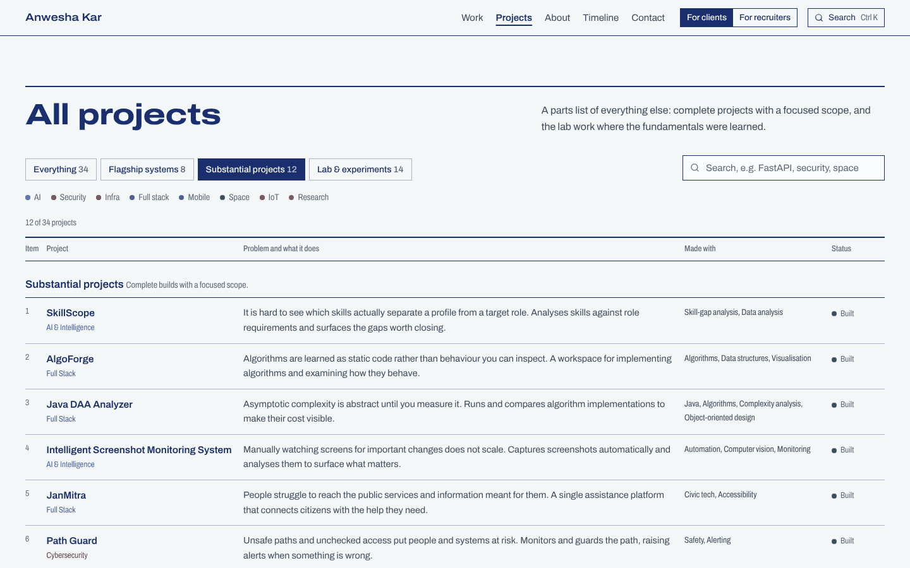

# Anwesha Kar — portfolio

The portfolio of **Anwesha Kar**, an AI/ML and full-stack developer working across backend APIs, security and infrastructure.

> I don’t just build apps. I build systems.

The site is drawn like an engineering drawing. The homepage is one sheet: the eight flagship systems are components with callout letters A to H, wired together by the technologies they actually share, and a drawing title block carries the name, role and the way to start a project. Each component has a detail drawing further down: a working model you can use and break.


| Detail drawings (simulations) | Parts list |
| --- | --- |
|  |  |
| **Case study** | **Mobile** |
|  |  |

## Features

- **System schematic homepage.** The eight flagships are drawn as components and routed orthogonally along a bus by the technology or discipline they share. Pointing at a component marks it in red pencil, highlights its wires and adds its problem statement to the drawing's general notes. Clicking opens the case study. On phones the same components sit on a single vertical bus.
- **Title block.** Name, title, discipline, availability and the main call to action, in the place a drawing keeps its identity.
- **Detail drawings A to H.** Each one runs as an interactive model, labelled as a simulation:
  - EventMesh: retries, dead-letter queue, idempotency and rate limiting
  - NEXUS: anomaly detection, isolation and restore
  - RESQMesh: information-pressure payload shaping
  - ChronoHeritage: a request's journey across the containers
  - CareerOS: skills mapped to roles
  - BoundaryLens: an IDOR/BOLA authorization playground
  - PrepAI: a multi-persona group discussion with a scoring rubric
  - BalloonSat: mission control on a standard-atmosphere model
- **Case studies.** Problem, why it matters, limitation, idea, architecture diagram, how it works, stack, decisions, reliability, challenges, implementation, live model, lessons, next iteration, and a call to action tied to that project.
- **Parts list.** All 34 projects in one numbered table, grouped into flagship systems, substantial projects and lab work. Filter by level or discipline, or search in plain language.
- **Client and recruiter views.** Clients see services, each tied to the projects that prove it. Recruiters see areas of technical depth, research and experience. The choice is remembered.
- **Search (⌘K / Ctrl K).** Keyboard-driven, local, no API key. Try `FastAPI`, `docker`, `distributed systems` or `projects using react`. A few easter eggs: `lumos`, `nox`, `mischief managed`.
- **Tools graph.** A layered network from disciplines to technologies to projects. Selecting a technology traces every project that uses it.
- **Process flowchart, timeline and GitHub activity.** The GitHub section is fetched live in the visitor's browser and cached for the session, with loading and error states.
- **Project brief.** Visitors write a brief and copy it, or send it through whichever contact channel is configured.
- **Details.** A 404 page that is "not on the Marauder’s Map", reduced-motion support, a skip link, visible focus and ARIA throughout.

## Design system

| Token | Value | Use |
| --- | --- | --- |
| Paper | `#f4f7f8` | Background |
| Sheet | `#fbfcfd` | Drawing sheets and panels |
| Ink | `#1b2f6e` | All text and lines |
| Blueprint | `#2d5be3` | Active and selected states |
| Red pencil | `#b3301f` | Annotations and failure paths |
| Ochre, verdigris | `#87570c`, `#2b7a4b` | Simulation states only |

One typeface, **Archivo**, does everything through its width axis: expanded and heavy for headings, normal for text, condensed for notes and table cells. There are no all-caps labels or monospace. Numbering appears only where the content really is a sequence (the process, the parts list, the general notes). The only unprompted motion is the schematic's wires drawing in once on load.

## Tech stack

| Layer | Choice |
| --- | --- |
| Framework | Next.js 16 (App Router, Turbopack), React 19, TypeScript |
| Styling | Tailwind CSS v4, tokens in `src/app/globals.css` |
| Motion | CSS only, plus Lenis smooth scrolling |
| Icons | lucide-react, plus inline brand SVGs |
| Type | Archivo (SIL OFL), self-hosted through `next/font` |

## Architecture

```
src/
  app/                    routes, metadata, sitemap, robots, OG images, 404
    projects/             parts list + /projects/[slug] case studies (statically generated)
  components/
    home/                 schematic, title block, detail drawings, services, tools graph, process, about, timeline, GitHub, contact
    sims/                 eight code-split simulations + shared chrome
    projects/             parts list, architecture diagram
    palette/ nav/ providers/ ui/
  data/                   single source of truth: projects, categories, technologies, services, timeline, process, site
  lib/                    shared-technology graph, search, scroll helpers, hooks, OG renderer
```

Everything comes from `src/data/projects.ts`: the schematic and its wires, the parts list, the tools graph, search, the case studies, the sitemap and the share images. To add a project, add one typed entry to that file.

## Local development

```bash
npm install
npm run dev          # http://localhost:3000
npm run lint
npm run typecheck
npm run build && npm run start
```

Requires Node.js 20.9 or later.

### Configuration

Copy `.env.example` to `.env.local`. Any contact channel left empty is hidden across the whole site.

| Variable | Purpose |
| --- | --- |
| `NEXT_PUBLIC_SITE_URL` | Canonical URL for metadata, sitemap and robots |
| `NEXT_PUBLIC_CONTACT_EMAIL` | Enables the email channel and the direct mail button |
| `NEXT_PUBLIC_LINKEDIN_URL` | LinkedIn channel |
| `NEXT_PUBLIC_UPWORK_URL` | Upwork channel |

To link a project's repository or live demo, set `github` / `demo` on its entry in `src/data/projects.ts`. Links appear only when they exist.

## Performance

Lighthouse 12 on the production build (`next start`), homepage:

| Run | Performance | Accessibility | Best practices | SEO |
| --- | --- | --- | --- | --- |
| Mobile | 93–98 | 100 | 100 | 100 |
| Desktop | 100 | 100 | 100 | 100 |

The homepage drawing is plain HTML and SVG, so there is no WebGL or animation runtime. Simulations and the tools graph mount only when they near the viewport, and each simulation is its own code-split chunk.

## Deployment (Vercel)

1. Import the repository at [vercel.com/new](https://vercel.com/new). Next.js is detected automatically.
2. Add the environment variables above. At minimum set `NEXT_PUBLIC_SITE_URL` to the production domain.
3. Deploy. Every route is static, so no server-side secrets are needed.

With the CLI: `npx vercel` for a preview deploy, `npx vercel --prod` for production.

## Honesty notes

- Every simulation is an illustrative model and says so. None of them show recorded data or real metrics.
- There are no testimonials, client logos or invented numbers. The counts on the site are counts of entries in the project data.
- Timeline dates appear only where they are confirmed.

## License

Code is released under the MIT License (see `LICENSE`). Project descriptions, case-study writing and personal content © Anwesha Kar, all rights reserved. Archivo is licensed under the SIL Open Font License.
