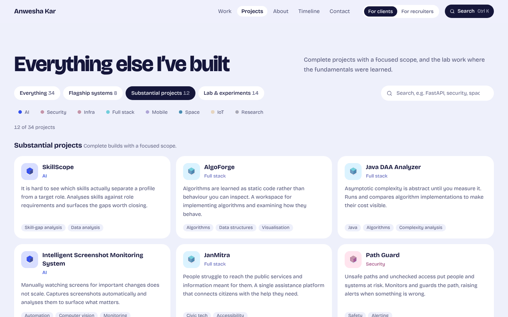

# Anwesha Kar — portfolio

The portfolio of **Anwesha Kar**, an AI/ML and full-stack developer working across backend APIs, security and infrastructure.

> I don’t just build apps. I build systems.

The homepage is a small isometric city. Each of the eight flagship systems is a coloured machine on the map, connected by roads wherever two systems share a technology or discipline, with packets travelling along them. Every machine opens its case study, and each one also runs further down the page as a working model you can use and break.


| Simulations | Project archive |
| --- | --- |
|  |  |
| **Case study** | **Mobile** |
|  |  |

## Features

- **Isometric systems map.** The eight flagships are built as isometric machines and linked by roads for the technologies they share. Hovering or focusing a machine lifts it, highlights its roads and offers its case study. On phones the map is followed by a list of the systems, because the labels would be too small to read.
- **Eight interactive simulations**, each clearly labelled as one:
  - EventMesh: retries, dead-letter queue, idempotency and rate limiting
  - NEXUS: anomaly detection, isolation and restore
  - RESQMesh: information-pressure payload shaping
  - ChronoHeritage: a request's journey across the containers
  - CareerOS: skills mapped to roles
  - BoundaryLens: an IDOR/BOLA authorization playground
  - PrepAI: a multi-persona group discussion with a scoring rubric
  - BalloonSat: mission control on a standard-atmosphere model
- **Case studies.** Problem, why it matters, limitation, idea, architecture diagram, how it works, stack, decisions, reliability, challenges, implementation, live model, lessons, next iteration, and a call to action tied to that project.
- **Project archive.** All 34 projects, grouped into flagship systems, substantial projects and lab work. Filter by level or discipline, or search in plain language.
- **Client and recruiter views.** Clients see services, each tied to the projects that prove it. Recruiters see areas of technical depth, research and experience. The choice is remembered.
- **Search (⌘K / Ctrl K).** Keyboard-driven, local, no API key. Try `FastAPI`, `docker`, `distributed systems` or `projects using react`. A few easter eggs: `lumos`, `nox`, `mischief managed`.
- **Toolbox.** Technologies grouped on shelves by discipline. Picking a tool lists every project that uses it. There are no skill bars or percentages.
- **How I work, timeline and GitHub activity.** The GitHub section is fetched live in the visitor's browser and cached for the session, with loading and error states.
- **Project brief.** Visitors write a brief and copy it, or send it through whichever contact channel is configured.
- **Details.** A 404 page that is "not on the Marauder’s Map", reduced-motion support (the packets stop and nothing animates), a skip link, visible focus and ARIA throughout.

## Design system

| Token | Value | Use |
| --- | --- | --- |
| Field | `#eef0fb` | Page background, the ground of the map |
| Card | `#ffffff` | Cards, panels and road surfaces |
| Ink | `#15163a` | Text, primary buttons, the footer |
| Cobalt | `#3451f2` | Main call to action, the contact panel |
| Block colours | cobalt `#3b5bff`, tangerine `#ff7b47`, mint `#2fd3a0`, lemon `#ffd24a`, lilac `#b8a6ff`, rose `#ff7aa8`, sky `#4cc3ff` | One per system and per discipline; used for fills, never for text |
| Text-safe accents | red `#d33547`, amber `#a35f00`, green `#0d8459` | Simulation states, all AA on white |

Type is **Bricolage Grotesque**, a variable font with optical-size and width axes: heavy and tight at display sizes, relaxed for body text. Shapes are rounded (24px cards, pill buttons and filters), and each system keeps its colour everywhere it appears: on the map, in the simulation tabs, the archive, the case study header and the share image. The isometric shapes are generated from simple block specs in `src/lib/iso.ts` and drawn as plain SVG.

## Tech stack

| Layer | Choice |
| --- | --- |
| Framework | Next.js 16 (App Router, Turbopack), React 19, TypeScript |
| Styling | Tailwind CSS v4, tokens in `src/app/globals.css` |
| Motion | CSS and SVG (SMIL) only, plus Lenis smooth scrolling |
| Icons | lucide-react, plus inline brand SVGs |
| Type | Bricolage Grotesque (SIL OFL), self-hosted through `next/font` |

## Architecture

```
src/
  app/                    routes, metadata, sitemap, robots, OG images, 404
    projects/             project archive + /projects/[slug] case studies (statically generated)
  components/
    home/                 hero, flagship simulations, services, toolbox, process, about, timeline, GitHub, contact
    iso/                  isometric machines and the systems map
    sims/                 eight code-split simulations + shared chrome
    projects/             archive, project tiles, architecture diagram
    palette/ nav/ providers/ ui/
  data/                   single source of truth: projects, categories, technologies, services, timeline, process, site
  lib/                    isometric geometry, shared-technology graph, search, scroll helpers, hooks, OG renderer
```

Everything comes from `src/data/projects.ts`: the map and its roads, the archive, the toolbox, search, the case studies, the sitemap and the share images. To add a project, add one typed entry to that file.

## Local development

```bash
npm install
npm run dev          # http://localhost:3000
npm run lint
npm run typecheck
npm run build && npm run start
```

Requires Node.js 20.9 or later.

### Configuration

Copy `.env.example` to `.env.local`. Any contact channel left empty is hidden across the whole site.

| Variable | Purpose |
| --- | --- |
| `NEXT_PUBLIC_SITE_URL` | Canonical URL for metadata, sitemap and robots |
| `NEXT_PUBLIC_CONTACT_EMAIL` | Enables the email channel and the direct mail button |
| `NEXT_PUBLIC_LINKEDIN_URL` | LinkedIn channel |
| `NEXT_PUBLIC_UPWORK_URL` | Upwork channel |

To link a project's repository or live demo, set `github` / `demo` on its entry in `src/data/projects.ts`. Links appear only when they exist.

## Performance

Lighthouse 12 on the production build (`next start`), homepage:

| Run | Performance | Accessibility | Best practices | SEO |
| --- | --- | --- | --- | --- |
| Mobile | 92–95 | 100 | 100 | 100 |
| Desktop | 100 | 100 | 100 | 100 |

The homepage map is plain HTML and SVG, so there is no WebGL or animation runtime. Simulations mount only when they near the viewport, and each simulation is its own code-split chunk.

## Deployment (Vercel)

1. Import the repository at [vercel.com/new](https://vercel.com/new). Next.js is detected automatically.
2. Add the environment variables above. At minimum set `NEXT_PUBLIC_SITE_URL` to the production domain.
3. Deploy. Every route is static, so no server-side secrets are needed.

With the CLI: `npx vercel` for a preview deploy, `npx vercel --prod` for production.

## Honesty notes

- Every simulation is an illustrative model and says so. None of them show recorded data or real metrics.
- There are no testimonials, client logos or invented numbers. The counts on the site are counts of entries in the project data.
- Timeline dates appear only where they are confirmed.

## License

Code is released under the MIT License (see `LICENSE`). Project descriptions, case-study writing and personal content © Anwesha Kar, all rights reserved. Bricolage Grotesque is licensed under the SIL Open Font License.
